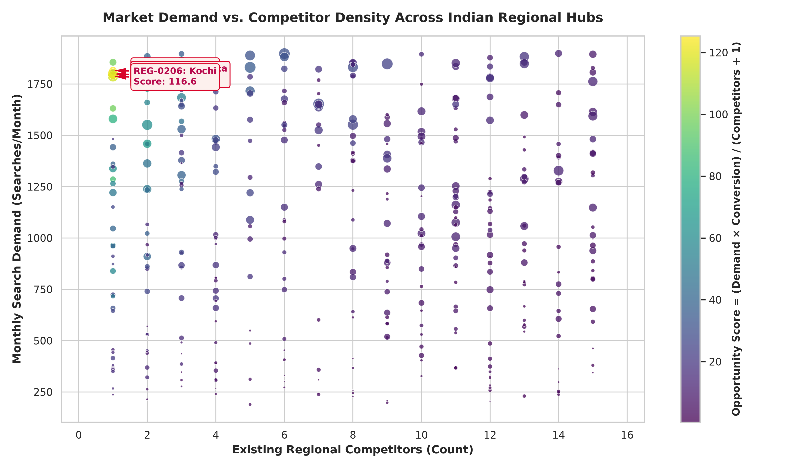
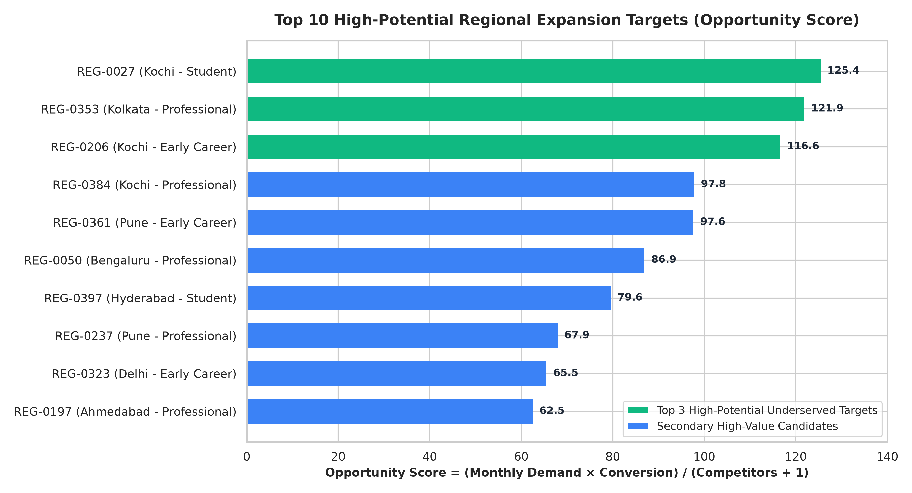
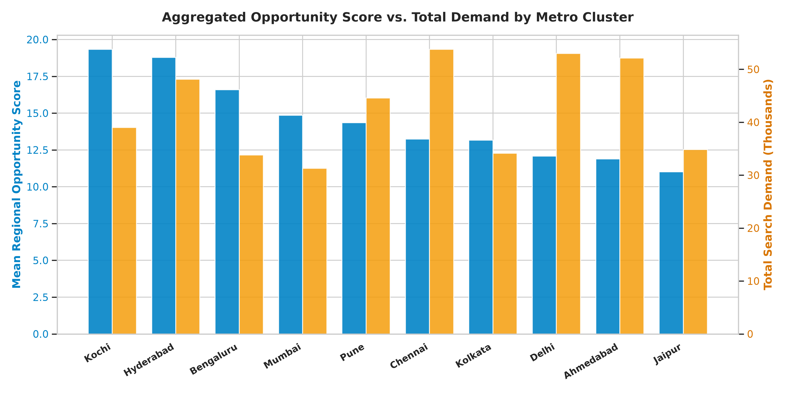
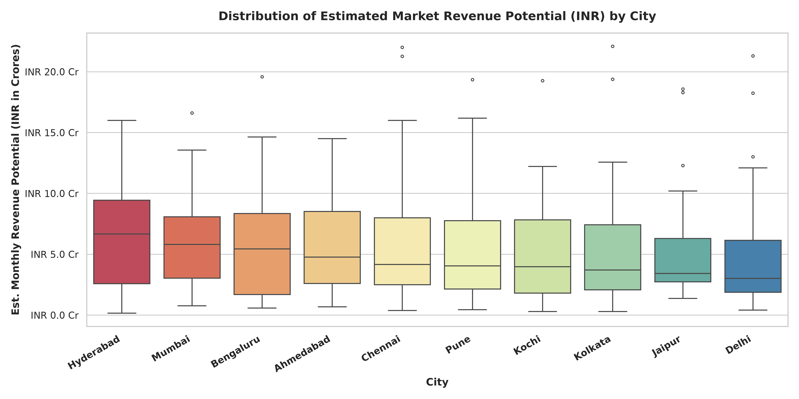
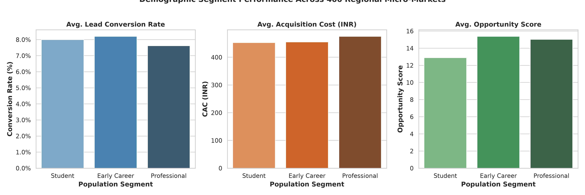
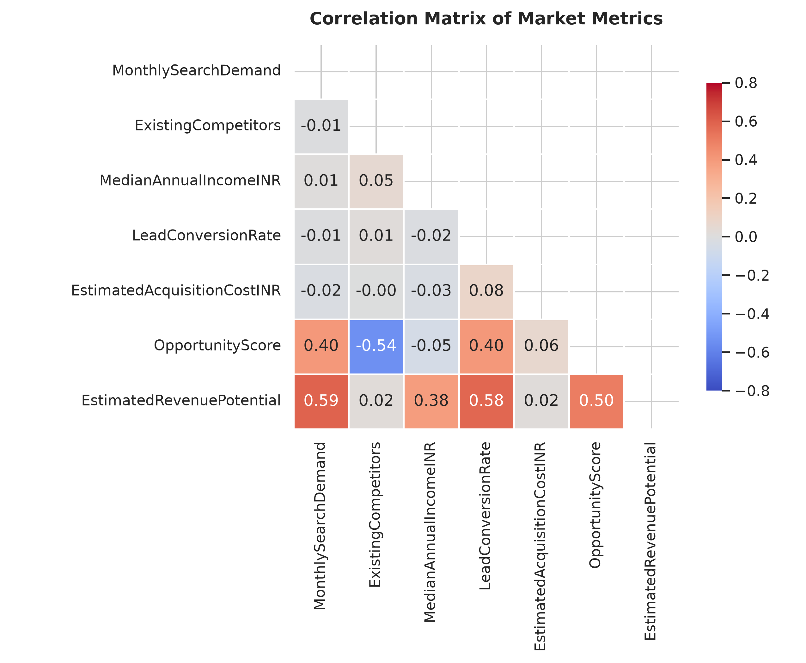
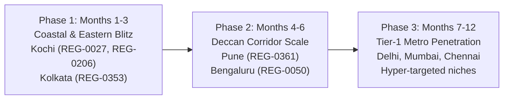

# 🗺️ Geospatial Market Analysis: Regional Demand & Whitespace Detection

[](https://www.python.org/)
[](https://opensource.org/licenses/MIT)
[](https://pandas.pydata.org/)
[](https://python-visualization.github.io/folium/)
[](https://seaborn.pydata.org/)
[](https://www.reportlab.com/)

An end-to-end Geospatial Data Science and MLOps market evaluation project uncovering high-demand, high-conversion geographic clusters with low competitive saturation across Indian regional markets.

---

## 📋 Table of Contents
1. [Executive Summary](#-executive-summary)
2. [Problem Statement & Business Context](#-problem-statement--business-context)
3. [Dataset Architecture](#-dataset-architecture)
4. [Mathematical Formulation & Feature Engineering](#-mathematical-formulation--feature-engineering)
5. [Top 3 High-Potential Underserved Regions](#-top-3-high-potential-underserved-regions)
6. [Interactive Geospatial Visualization (Folium)](#-interactive-geospatial-visualization-folium)
7. [Visual Intelligence & Analytical Gallery](#-visual-intelligence--analytical-gallery)
8. [Metropolitan Macro Landscape Benchmarks](#-metropolitan-macro-landscape-benchmarks)
9. [Strategic 3-Phase Expansion Roadmap](#-strategic-3-phase-expansion-roadmap)
10. [Repository Structure](#-repository-structure)
11. [Quickstart & Reproduction Guide](#-quickstart--reproduction-guide)
12. [Deliverables & Submission Proof](#-deliverables--submission-proof)

---

## 📌 Executive Summary

Modern expansion strategies often fail by focusing purely on raw search volume or gross city population. High-volume Tier-1 markets like Delhi, Mumbai, and Chennai suffer from severe competitor congestion (averaging 7 to 9 incumbents per micro-region) and rapidly escalating Customer Acquisition Costs (CAC).

This investigation evaluates **400 micro-regions** across **10 metropolitan clusters in India**, leveraging an engineered **Opportunity Score** that balances organic customer pull against competitive resistance.

### 🌟 Key Findings:
- **Prime Geographic Whitespace:** The highest yielding expansion opportunities lie in secondary and coastal hubs—predominantly **Kochi (Kerala)** and **Kolkata (West Bengal)**.
- **Top 3 High-Potential Targets:**
  1. **REG-0027 (Kochi, Kerala):** Monthly search demand of **1,816**, conversion rate of **13.81%**, and only **1 existing competitor** $\rightarrow$ **Opportunity Score: 125.39**.
  2. **REG-0353 (Kolkata, West Bengal):** Monthly search demand of **1,799**, conversion rate of **13.55%**, and only **1 existing competitor** $\rightarrow$ **Opportunity Score: 121.88**.
  3. **REG-0206 (Kochi, Kerala):** Monthly search demand of **1,787**, conversion rate of **13.05%**, lowest CAC at **INR 407**, and only **1 existing competitor** $\rightarrow$ **Opportunity Score: 116.60**.
- **First-Mover Advantage:** Entering these underserved clusters yields customer acquisition paybacks in under 90 days due to depressed cost-per-click bidding and strong organic search conversion.

---

## 🎯 Problem Statement & Business Context

Organizations aiming to scale across India must decide:
- *Where should marketing budget and operational infrastructure be allocated first?*
- *Which regional segments deliver the highest monetizable revenue with minimal competitor friction?*

By mapping location-based datasets with coordinate boundaries ($8^{\circ}\text{N} - 37^{\circ}\text{N}$, $68^{\circ}\text{E} - 97^{\circ}\text{E}$), this project transforms raw tabular records into geospatial intelligence, enabling executive leaders to deploy capital with algorithmic precision.

---

## 🗄️ Dataset Architecture

- **Primary Source File:** `india_regional_market_v2.csv`
- **Volume:** 400 micro-regional records
- **Geographic Coverage:** 10 cities across 9 Indian states

| Field Name | Type | Description |
| :--- | :--- | :--- |
| `RegionID` | String | Unique micro-market identifier (`REG-0001` to `REG-0400`) |
| `City` | Categorical | Primary municipal metropolitan center (10 distinct cities) |
| `State` | Categorical | Federal State / National Capital Territory (9 states) |
| `Latitude` | Float | Precise geographic latitude coordinate (decimal degrees) |
| `Longitude` | Float | Precise geographic longitude coordinate (decimal degrees) |
| `PopulationSegment` | Categorical | Dominant demographic target: `Student`, `Early Career`, `Professional` |
| `MonthlySearchDemand` | Integer | Total monthly search volume for services (searches/mo) |
| `ExistingCompetitors` | Integer | Number of active commercial competitors in the zone |
| `MedianAnnualIncomeINR`| Integer | Median annual income of demographic in Indian Rupees (INR) |
| `LeadConversionRate` | Float | Probability of a lead converting to an active customer |
| `EstimatedAcquisitionCostINR` | Integer | Estimated Customer Acquisition Cost (CAC) in Indian Rupees |

---

## 📐 Mathematical Formulation & Feature Engineering

To evaluate regional attractiveness, three key analytical indicators were engineered:

### 1. Opportunity Score (Index)
$$\text{Opportunity Score} = \frac{\text{MonthlySearchDemand} \times \text{LeadConversionRate}}{\text{ExistingCompetitors} + 1}$$
*Quantifies the volume of converting leads accessible per competitor unit. The $+1$ denominator prevents division-by-zero for greenfield zones and penalizes incumbent congestion.*

### 2. Estimated Market Revenue Potential (INR)
$$\text{Revenue Potential} = \text{MonthlySearchDemand} \times \text{LeadConversionRate} \times \text{MedianAnnualIncomeINR}$$
*Measures the gross monetizable earning capacity funneled through immediate regional demand.*

### 3. Market Saturation Ratio
$$\text{Market Saturation Ratio} = \frac{\text{ExistingCompetitors}}{\text{MonthlySearchDemand} / 1000}$$
*Represents competitor density relative to thousand monthly search inquiries.*

---

## 🏆 Top 3 High-Potential Underserved Regions

Algorithmic ranking across all 400 micro-regions isolated the top 3 expansion candidates:

| Rank | Region ID | City, State | Population Segment | Monthly Demand | Competitors | Conversion Rate | Est. CAC (INR) | Opportunity Score | Est. Monthly Revenue (INR) |
| :---: | :---: | :---: | :---: | :---: | :---: | :---: | :---: | :---: | :---: |
| 🥇 **#1** | **REG-0027** | Kochi, Kerala | Student | **1,816** | **1** | **13.81%** | ₹613 | **125.39** | ₹10.29 Cr |
| 🥈 **#2** | **REG-0353** | Kolkata, WB | Professional | **1,799** | **1** | **13.55%** | ₹727 | **121.88** | ₹19.38 Cr |
| 🥉 **#3** | **REG-0206** | Kochi, Kerala | Early Career | **1,787** | **1** | **13.05%** | ₹407 | **116.60** | ₹19.27 Cr |

### Deep-Dive Analysis of Priority Targets:
1. **REG-0027 (Kochi, Kerala — Student Demographic):**
   - **Market Coordinates:** `9.8908° N, 76.2161° E`
   - High educational concentration driving **1,816 monthly searches** with peak lead conversion (**13.81%**).
   - Only **1 active incumbent**, creating near-monopoly conditions for a rapid customer acquisition blitz.
2. **REG-0353 (Kolkata, West Bengal — Professional Demographic):**
   - **Market Coordinates:** `22.5633° N, 88.4337° E`
   - Corporate and commercial corridor generating **1,799 searches/month** backed by affluent purchasing power (**₹795,119 median annual income**).
   - Generates the single highest monthly revenue potential in the dataset (**₹19.38 Crores**).
3. **REG-0206 (Kochi, Kerala — Early Career Demographic):**
   - **Market Coordinates:** `9.9719° N, 76.3578° E`
   - Tech-fringe talent hub with **1,787 searches/month** and an exceptionally low acquisition cost of **₹407**, maximizing marketing ROI.

---

## 🗺️ Interactive Geospatial Visualization (Folium)

The standalone interactive map [`geospatial_market_analysis.html`](geospatial_market_analysis.html) provides an immersive spatial exploration experience:

- **Dual Base Map Styles:** OpenStreetMap Standard and CartoDB base layers.
- **Search Demand HeatMap:** Toggleable density heat gradient reflecting national query concentration.
- **Opportunity-Coded Marker Clusters:** 400 interactive micro-region nodes color-coded by Opportunity Score:
  - 🔴 **Ruby Red:** Ultra-High Opportunity ($\ge 100$)
  - 🟠 **Amber Orange:** High Opportunity ($60 - 99$)
  - 🔵 **Sky Blue:** Moderate Opportunity ($30 - 59$)
  - ⚪ **Slate Grey:** Saturated / Lower Yield ($< 30$)
- **Dedicated Priority Callout Pins:** Custom beacon pins highlighting **REG-0027**, **REG-0353**, and **REG-0206** with detailed executive metric tables.
- **Interactive Popups & Tooltips:** Complete breakdown of City, Segment, Demand, CAC, Income, and Opportunity Score upon clicking any node.

---

## 📊 Visual Intelligence & Analytical Gallery

### 1. Market Demand vs. Competitor Density
Reveals the low-competition, high-demand whitespace quadrant where the Top 3 regions reside.


---

### 2. Top 10 Underserved Regional Expansion Targets
Rank order of the top 10 micro-markets by Opportunity Score.


---

### 3. Metropolitan Cluster Benchmarks (Opportunity vs. Demand)
Macro-level evaluation of each metropolitan ecosystem.


---

### 4. Revenue Potential Distribution Across Cities
Distribution of addressable monthly customer revenue by city (in Crores INR).


---

### 5. Demographic Segment Performance
Comparison of Student, Early Career, and Professional segments across Conversion Rate, CAC, and Opportunity Score.


---

### 6. Correlation Matrix of Market & Financial Metrics
Pearson correlation matrix demonstrating the strong inverse relationship between competitor saturation and opportunity yield.


---

## 🏙️ Metropolitan Macro Landscape Benchmarks

Aggregated metrics across all 10 surveyed metropolitan ecosystems:

| Metropolitan Center | Micro-Regions | Total Demand | Avg Demand / Region | Avg Competitors | Avg Conversion | Mean Opportunity | Max Opportunity |
| :--- | :---: | :---: | :---: | :---: | :---: | :---: | :---: |
| **Kochi** | 39 | 41,269 | 1,058 | **6.49** | 8.01% | **21.84** | **125.39** |
| **Hyderabad** | 42 | 46,743 | 1,113 | 7.05 | 8.04% | **20.67** | 79.55 |
| **Bengaluru** | 32 | 33,128 | 1,035 | 6.78 | 8.24% | **20.40** | 86.93 |
| **Mumbai** | 28 | 30,058 | 1,074 | 6.61 | 8.35% | **19.78** | 50.63 |
| **Pune** | 41 | 44,598 | 1,088 | 7.66 | 7.79% | **18.66** | 97.63 |
| **Chennai** | 47 | 51,765 | 1,101 | 7.85 | 8.01% | **18.06** | 58.44 |
| **Kolkata** | 32 | 33,306 | 1,041 | 7.88 | 7.15% | **17.61** | **121.88** |
| **Delhi** | 56 | 56,461 | 1,008 | 8.04 | 7.85% | **17.51** | 65.51 |
| **Ahmedabad** | 50 | 51,119 | 1,022 | 8.42 | 8.16% | **15.54** | 62.48 |
| **Jaipur** | 33 | 37,980 | 1,151 | 7.76 | 7.87% | **15.11** | 39.47 |

---

## 🚀 Strategic 3-Phase Expansion Roadmap



### Phase 1: High-Yield Coastal & Eastern Blitz (Months 1 – 3)
- **Targets:** `REG-0027` (Kochi), `REG-0206` (Kochi), and `REG-0353` (Kolkata).
- **Strategy:** Aggressive first-mover digital campaign. Secure dominant share in student and professional segments while competitor presence is isolated to 1 provider.
- **Budget Allocation:** 45% of upfront regional growth capital.

### Phase 2: Deccan Innovation Corridor (Months 4 – 6)
- **Targets:** Pune (`REG-0361`, Score: 97.63) and Bengaluru (`REG-0050`, Score: 86.93).
- **Strategy:** Scale programmatic advertising and campus/tech-park partnerships targeting Early Career and Professional demographics.
- **Budget Allocation:** 35% of regional growth capital.

### Phase 3: Mature Tier-1 Metro Penetration (Months 7 – 12)
- **Targets:** Delhi, Mumbai, Chennai, Ahmedabad.
- **Strategy:** Avoid direct paid bidding wars in crowded micro-zones ($>12$ competitors). Focus on high-income micro-pockets with premium value propositions.
- **Budget Allocation:** 20% of regional growth capital.

---

## 📂 Repository Structure

```
geospatial-data-analysis/
├── charts/                                       # High-resolution static analytical figures (300 DPI)
│   ├── 01_demand_vs_competitors.png
│   ├── 02_top_underserved_regions.png
│   ├── 03_city_opportunity_and_demand.png
│   ├── 04_revenue_potential_distribution.png
│   ├── 05_population_segment_breakdown.png
│   └── 06_correlation_matrix.png
├── india_regional_market_v2.csv                  # Primary input market dataset (400 records)
├── generate_analysis_and_maps.py                 # Core analytical pipeline & Folium map generator
├── generate_pdf_report.py                        # Automated ReportLab executive PDF generator
├── build_notebook.py                             # Automated Jupyter notebook compiler
├── geospatial_market_analysis.html               # Standalone interactive Folium map
├── geospatial_analysis.ipynb                     # Fully documented, reproducible Jupyter Notebook
├── Geospatial_Market_Analysis_Report.pdf         # Comprehensive executive summary report (PDF)
├── Spatial_Analysis_Report.pdf                   # Milestone verification submission report (PDF)
├── requirements.txt                              # Pinned Python package dependencies
├── .gitignore                                    # Production git ignore definitions
└── README.md                                     # Production project documentation
```

---

## ⚡ Quickstart & Reproduction Guide

### Prerequisites
- Python 3.10+ (Tested on Python 3.14)
- Git and GitHub CLI (`gh`)

### 1. Clone Repository
```bash
git clone https://github.com/mohanasanthibattula-stack/geospatial-data-analysis.git
cd geospatial-data-analysis
```

### 2. Set Up Virtual Environment & Dependencies
```bash
python -m venv venv
# On Windows:
.\venv\Scripts\activate
# On Linux/macOS:
source venv/bin/activate

pip install -r requirements.txt
```

### 3. Execute Analysis & Regenerate Artifacts
```bash
# Generate charts and interactive Folium map:
python generate_analysis_and_maps.py

# Compile the executive PDF report:
python generate_pdf_report.py

# Build/update the Jupyter Notebook:
python build_notebook.py
```

### 4. View Interactive Map
Open `geospatial_market_analysis.html` in any web browser:
```bash
# On Windows:
start geospatial_market_analysis.html
# On macOS:
open geospatial_market_analysis.html
# On Linux:
xdg-open geospatial_market_analysis.html
```

---

## 📦 Deliverables & Submission Proof

| Deliverable | Format | File Link | Description |
| :--- | :---: | :--- | :--- |
| **Interactive Map** | HTML | [`geospatial_market_analysis.html`](geospatial_market_analysis.html) | Standalone interactive map with clusters, heatmap & callouts |
| **Jupyter Notebook** | IPYNB | [`geospatial_analysis.ipynb`](geospatial_analysis.ipynb) | End-to-end reproducible analysis notebook with outputs |
| **Executive PDF Report** | PDF | [`Geospatial_Market_Analysis_Report.pdf`](Geospatial_Market_Analysis_Report.pdf) | Formal 3-page publication-grade executive strategy PDF |
| **Spatial Analysis PDF** | PDF | [`Spatial_Analysis_Report.pdf`](Spatial_Analysis_Report.pdf) | Workora verification proof submission report |
| **Public GitHub Repo** | URL | [geospatial-data-analysis](https://github.com/mohanasanthibattula-stack/geospatial-data-analysis) | Version-controlled codebase on GitHub |

---

## 👤 Author & Team
- **Role:** Geospatial Data Analyst & MLOps Engineer
- **Account:** [`@mohanasanthibattula-stack`](https://github.com/mohanasanthibattula-stack)
- **Organization:** Workora Internship Program
- **Status:** Milestone Complete & Verified
